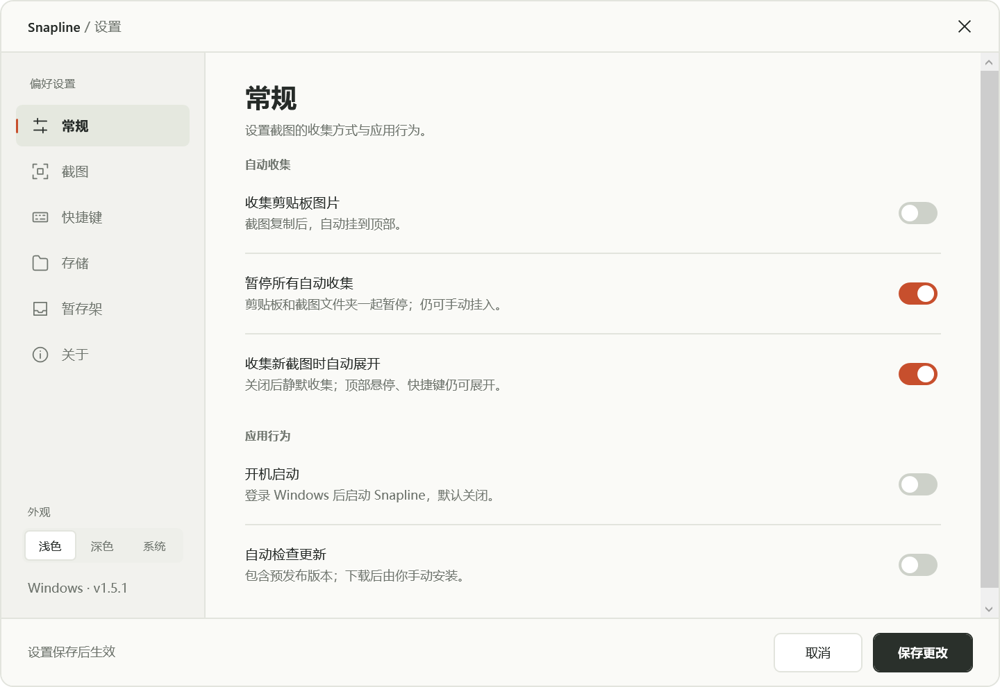

<p align="center">
  
</p>

<h1 align="center">Snapline</h1>

<p align="center"><strong>Keep screenshots at the top of your screen and temporary files within reach.</strong></p>
<p align="center">A screenshot clothesline, floating file shelf and offline image / PDF tools for Windows.</p>
<p align="center">Windows 桌面截图与文件工具，平时收起，需要时展开。</p>

<p align="center">
  <a href="https://github.com/jiuyang5354/snapline-windows/releases/tag/v1.5.1"></a>
  <a href="#download"></a>
  <a href="#download"></a>
  <a href="LICENSE"></a>
</p>

<p align="center"><a href="https://github.com/jiuyang5354/snapline-windows/releases/download/v1.5.1/Snapline-Windows-Setup-v1.5.1.exe">Download EXE</a> · <a href="#quick-start">Quick start</a> · <a href="#features">Features</a> · <a href="#faq">FAQ</a> · <a href="docs/VERSIONS.md">Previous versions</a> · <a href="https://github.com/jiuyang5354/snapline-windows/issues">Feedback</a></p>
<p align="center"><a href="README.md">简体中文</a> | <strong>English</strong></p>

## Beta status

- This is a public prerelease. Compatibility across other machines and applications is still being evaluated; see the limitations and verification scope below.
- Back up screenshots, settings and shelf records before updating. [Previous releases](docs/VERSIONS.md) remain available for rollback.
- This is an **unofficial Windows implementation of [Tendedero](https://github.com/alejandrobujan/tendedero) by [Alejandro Buján](https://github.com/alejandrobujan)**, published and maintained by [jiuyang5354](https://github.com/jiuyang5354). It uses its own name and icon and is not an official release or endorsement by the upstream author.

## Download

Current version: **v1.5.1 Beta 2 · prerelease for testing**. Requires **Windows 10/11 and .NET Framework 4.8 or later**. WebP tools require 64-bit Windows.

| Package | Use |
| --- | --- |
| **[EXE installer](https://github.com/jiuyang5354/snapline-windows/releases/download/v1.5.1/Snapline-Windows-Setup-v1.5.1.exe)** | Recommended for most users. Creates a desktop shortcut by default and supports installation over an older version. |
| **[Portable ZIP](https://github.com/jiuyang5354/snapline-windows/releases/download/v1.5.1/Snapline-Windows-v1.5.1.zip)** | Exit the old app, extract the entire package and run `Snapline.exe`. |
| [Application source](https://github.com/jiuyang5354/snapline-windows/releases/download/v1.5.1/Snapline-Windows-Source-v1.5.1.zip) · [Installer source](https://github.com/jiuyang5354/snapline-windows/releases/download/v1.5.1/Snapline-Windows-Installer-Source-v1.5.1.zip) | Review or build the project. |
| [Installer checksums](https://github.com/jiuyang5354/snapline-windows/releases/download/v1.5.1/SHA256SUMS-Setup.txt) · [Portable and source checksums](https://github.com/jiuyang5354/snapline-windows/releases/download/v1.5.1/SHA256SUMS.txt) | SHA-256 verification. |

[Release notes](https://github.com/jiuyang5354/snapline-windows/releases/tag/v1.5.1) · **[Previous versions](docs/VERSIONS.md)** · [Issues and suggestions](https://github.com/jiuyang5354/snapline-windows/issues)

The installer defaults to `%LOCALAPPDATA%\Programs\Snapline` and lets you choose another directory. Upgrades preserve screenshots, settings, shelf records and existing shortcuts. Startup at login is off by default. Builds are unsigned, so Windows may display an unknown-publisher warning. See the [installer guide](windows/INSTALLER.zh-CN.md).

## Features

### Screenshot clothesline

Screenshots and copied images hang along the top of the screen, with transparent gaps, glass containers, metal clips and subtle physical feedback. Click to copy, double-click to preview, hold for about 0.45 seconds to edit in Paint, or drag into an application that accepts images or files.

- **History in groups of nine:** new images enter the latest group; use the wheel and arrows to browse earlier groups. History survives restart.
- **Quiet collection:** turn off automatic reveal in General settings. Images continue to save without opening the clothesline.
- **Custom shortcuts:** configure show/hide, region capture and clearing all screenshot groups separately.
- **Hover actions:** point at an image and press `C` to copy, `A` to edit or `D / Delete` to remove it.
- **Region capture:** select an area, optionally include the pointer, or press `Esc` to cancel.


The clothesline is shown on a generated presentation background using test images. Gaps remain transparent and the screenshot content itself is not filtered by the glass effect.

### Floating file shelf

The stack on the primary screen's right edge stages files and folders, supports multi-file stacks, an expanded grid, drag in/out, and text, link and image clippings.

- An empty shelf hides offscreen and appears after hovering at the right edge; a populated shelf stays visible as a stack.
- Hover or click to expand. Opening and closing transitions can be interrupted.
- Staged files and folders retain their original paths. Removing entries or clearing the shelf preserves the originals.
- Select files in the expanded shelf to open rename, conversion, compression, ZIP or PDF tools.

### Offline file tools

The five workbench modes share light/dark appearance and carry the current file list between tools. Outputs can join the file shelf; renaming updates screenshot history and shelf paths.

| Tool | Available operations |
| --- | --- |
| Batch rename | Original-name and sequence-number templates, preview and conflict checks; confirmation changes the source filenames. |
| Image conversion | PNG, JPEG, BMP, TIFF and static WebP, including lossy/lossless WebP output. |
| Image compression | JPEG quality and image long-edge limits; PNG can retain transparency. Results are saved separately. |
| ZIP | Package selected files and folders into a new archive. |
| Images to PDF | Individual image PDFs or multiple images combined into one PDF. |
| PDF pages | Merge, split, extract/reorder, delete, rotate, page numbers, text watermarks, set an opening password, or remove protection with the known password. |

Processing stays on the computer without uploading documents. Conversion and ZIP results are saved separately with collision-safe names, and background work can be canceled. Compression does not guarantee a smaller result; animated and multi-frame images are not supported.

**Scope:** image PDFs do not include OCR. Office conversion, PDF compression, OCR and digital signing are not available yet; interactive forms and digitally signed PDFs are not processed. Common PDF tasks support up to 512 pages, and merges accept up to 200 files with 128 MB of combined input. See the [PDF tools plan](windows/PDF-TOOLS-PLAN.zh-CN.md).

### Settings and everyday controls

Choose light, dark or system appearance; pause collection, copy the latest screenshot, change the inbox, opt into startup at login, check for updates or reopen release announcements.



Captured from an isolated v1.5.1 test instance. Settings use a solid background while screenshot containers retain their glass appearance. The switch states are test examples.

## Quick start

1. Install or extract the full package and run `Snapline.exe`. The app stays in the system tray.
2. Capture with `Win + Shift + S`, copy an image or use Snapline's region capture.
3. Hover at the screen top, click the tray icon or press `Ctrl + Alt + T` to reveal the clothesline.
4. Drag temporary files to the right-hand shelf and open a processing tool from its expanded panel.
5. Save changes to shortcuts, appearance, collection and storage in Settings.

| Default action | Shortcut |
| --- | --- |
| Show/hide screenshot bar | `Ctrl + Alt + T` |
| Region capture | `Ctrl + Alt + S` |
| Clear all screenshot groups, preserving original files | `Ctrl + Alt + Backspace` |

Change these in Settings → Shortcuts. If the default show shortcut is occupied, Snapline tries a fallback and shows the active binding in the tray. The tray icon may be under hidden icons.

## Files, drag and drop, and privacy

- Screenshots default to `%LOCALAPPDATA%\Snapline\Inbox`; settings are in `%LOCALAPPDATA%\Snapline\settings.json`. Changing the inbox does not move existing images.
- **Removing one image differs from clearing all:** the close button or `D / Delete` sends images in the current/default inbox to the Recycle Bin. External images and images in an old custom inbox only leave the clothesline. Clearing all screenshot groups preserves original files.
- Successful drops into accepting applications copy the image and retain its card. A drop into a nonaccepting area removes the card by default while preserving the file; `Esc` keeps the card. The nonaccepting-drop behavior can be disabled.
- The target must accept images/files. Snapline and the target should run at the same privilege level; elevated chat applications may reject drops from a normal process.
- Clipboard collection also includes qualifying copied images, not just screenshots. It can be disabled separately or paused with all automatic collection.
- Known text, tables, vector content and Office/WPS object previews are skipped. v1.5.1 also checks the WPS clipboard owner, so **ordinary images copied from WPS are skipped too**; use region capture when needed. The reporter's WPS environment still needs confirmation; see [Issue #2](https://github.com/jiuyang5354/snapline-windows/issues/2).
- Screenshot, shelf and processing content is not uploaded. Update checks read GitHub's public update file and downloads use GitHub and its asset CDN. Screenshots, clipboard content and local paths are not sent.

## Updates and previous versions

Automatic checks are on by default and **include prereleases**: an attempt occurs about 15 seconds after startup and at most once every 24 hours. Manual checks are available in the tray. Downloads validate size and SHA-256; installed users confirm the EXE upgrade, while portable users exit before extracting the full ZIP.

**Earlier Releases, installers, portable packages, source archives, checksums and tags remain available.** The [version index](docs/VERSIONS.md) lists their downloads and the [changelog](CHANGELOG.md) retains changes. Back up screenshots, settings and shelf records before reverting.

The previous introduction remains in Git history: [earlier English README](https://github.com/jiuyang5354/snapline-windows/blob/d39864addb2f2d050e441b73e36cadace6b3a8ad/README.en.md).

## Validation and feedback

v1.5.1 passed quiet-collection, clipboard format/source, constrained-memory, settings/motion, tool-integration and installation/upgrade/uninstall checks. Automated checks do not cover every user environment; the WPS report, other devices, multiple monitors and different scaling still need field feedback. See [QA](windows/QA.md).

When opening an [issue](https://github.com/jiuyang5354/snapline-windows/issues), include the app version, Windows version, steps and exact error. Startup reports can include `diagnostics.log`; clipboard reports can include `clipboard-error.log` from the app data folder. Private documents, design source files and complete settings files are not needed.

## FAQ

### Should I download the EXE or ZIP?

The **EXE installer** is recommended for most users and creates a desktop shortcut by default. The ZIP is portable: extract the entire package before running `Snapline.exe`. See [Download](#download).

### Why is there no window after launching?

Snapline runs in the system tray. Hover at the top edge, click its tray icon, or press the default `Ctrl + Alt + T` shortcut to reveal the clothesline. The icon may be under hidden tray icons.

### Why does a chat app reject a dragged image?

The receiving app must accept image or file drops, and both apps should run at the same privilege level. Try dragging the same file from File Explorer into the same input area as a control test.

### Are my files uploaded or deleted when removed?

Screenshot, shelf and file-tool processing stays local; update checks and downloads connect to GitHub. Removing shelf entries preserves the original files. Removing one screenshot and clearing all groups have different file-handling rules; see the file storage and privacy section.

## Build

The application uses **C#, WPF, Win32 and .NET Framework 4.8**. From the repository root:

```powershell
powershell.exe -NoProfile -ExecutionPolicy Bypass -File .\windows\build.ps1
```

Output is in `windows/bin/`. Keep the configuration and entire `Converters` directory beside the executable. The build downloads pinned conversion dependencies and checks SHA-256; release packages already include them. Building requires the appropriate .NET Framework development components; installer packaging also requires NSIS 3.13. See the [build and installer guide](windows/INSTALLER.zh-CN.md).

A [GitHub Packages / NuGet package](https://github.com/users/jiuyang5354/packages/nuget/package/jiuyang5354.Snapline.Windows) is available as `1.5.1-preview` and requires GitHub package authentication. Most users should choose the EXE or ZIP; developers can use the [package guide](windows/PACKAGE-README.md).

## Attribution and license

- **Tendedero author:** [Alejandro Buján](https://github.com/alejandrobujan), [upstream project](https://github.com/alejandrobujan/tendedero), reference commit `3c866d94d25ee9d1e008aecd9a78a4e9b2bf06a4`.
- **Windows publication and maintenance:** [jiuyang5354](https://github.com/jiuyang5354). This repository publishes the Windows implementation and is not the upstream author's official Windows release.
- The Windows implementation uses the [MIT license](LICENSE) and retains the [upstream license](UPSTREAM-LICENSE.txt). The upstream name, icon and its `docs/` images are outside that MIT grant; this project uses its own name, icon and generated demonstration material.
- File-shelf origins, PDFsharp, WebP, QingIcon and design references are documented in [NOTICE.md](NOTICE.md). Each component's license and notices are retained in the package.
