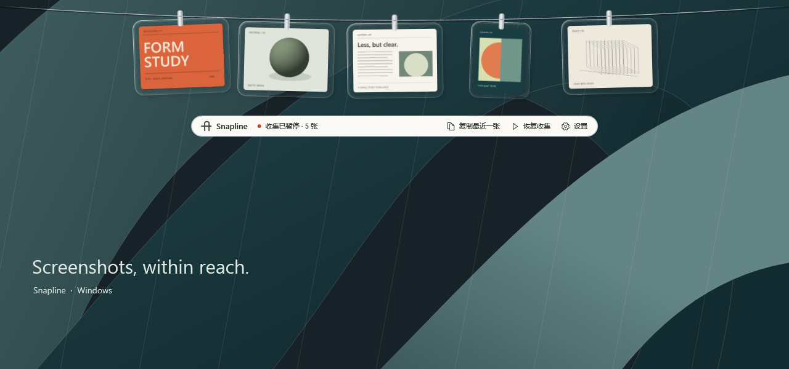
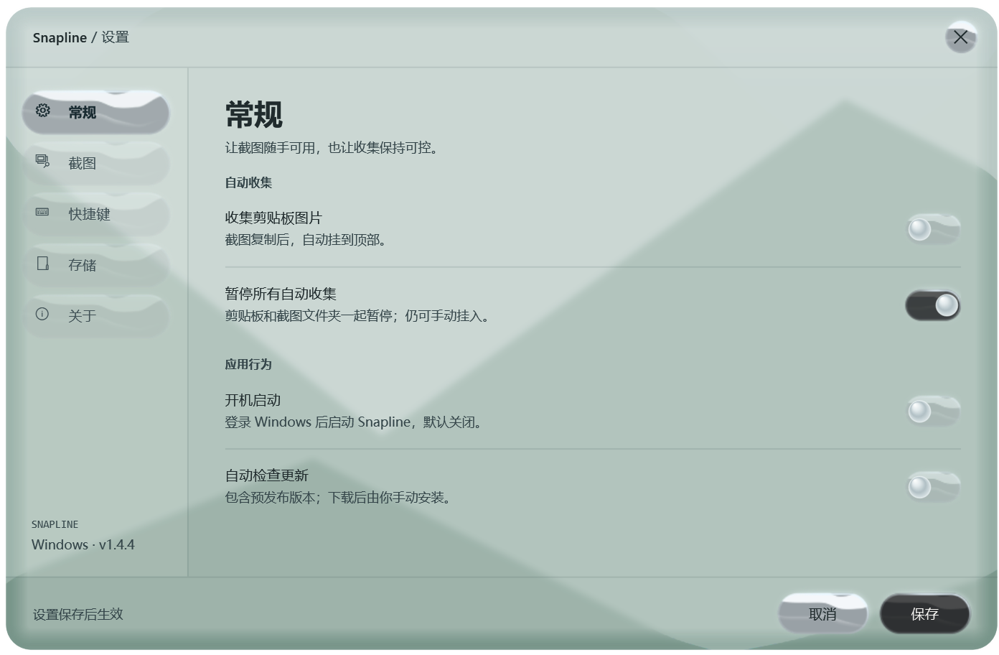
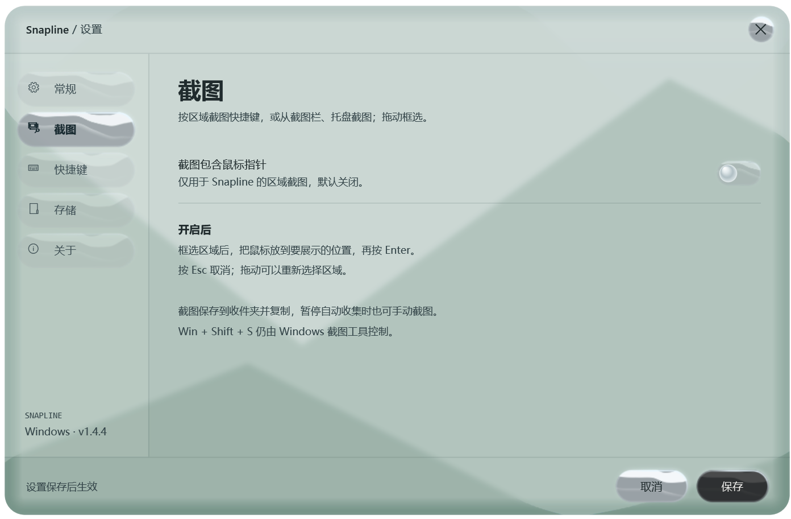

**中文** | [English](README.en.md)

# Snapline · 截图晾衣绳 Windows 版

Snapline 是 [Tendedero](https://github.com/alejandrobujan/tendedero) 的**非官方 Windows 移植版**。原项目作者为 **[Alejandro Buján](https://github.com/alejandrobujan)**；本仓库由 [jiuyang5354](https://github.com/jiuyang5354) 发布 Windows 实现。它把截图挂在屏幕顶部，方便复制、预览、编辑和拖入其他应用。

An unofficial Windows implementation of Tendedero by Alejandro Buján, using C# / WPF and Win32. This project uses its own name and icon and is not endorsed by the upstream author.

**v1.5.0 Beta 1：截图、暂存与离线文件工作台。** 新增侧边浮动文件暂存架、每 9 张截图一组的历史翻页，以及图片转格式、WebP、PDF 工具、批量重命名、图片压缩和 ZIP。五种工具使用统一的原生 WPF 界面，支持浅色 / 深色和跨工具携带文件；保留 v1.4.11 的 Office / WPS 对象筛选修复。原文件默认保留，重命名会先预览。本版为预发布测试版，已完成隔离安装、覆盖升级和工具集成验证，实际范围与待验证项目见 [验证记录](windows/QA.md)。



上图是实际 WPF 截图栏放在展示背景上的效果；截图与背景由程序生成。截图栏的液态玻璃用于每张截图的容器，空白区域保持透明。



上图为旧版设置窗口示意。v1.5 使用实色六页设置，支持浅色、深色和跟随系统；截图容器继续保留原有玻璃效果。PDF 和文件处理使用统一的原生工作台，完整功能见 [中文使用指南](windows/README.zh-CN.md)。

## 下载和运行

- [下载 Windows EXE 安装包（默认创建桌面图标）](https://github.com/jiuyang5354/snapline-windows/releases/download/v1.5.0/Snapline-Windows-Setup-v1.5.0.exe)
- [下载 Windows 便携包](https://github.com/jiuyang5354/snapline-windows/releases/download/v1.5.0/Snapline-Windows-v1.5.0.zip)
- [下载可编译源码包](https://github.com/jiuyang5354/snapline-windows/releases/download/v1.5.0/Snapline-Windows-Source-v1.5.0.zip)
- [安装器源码与验证记录](https://github.com/jiuyang5354/snapline-windows/releases/download/v1.5.0/Snapline-Windows-Installer-Source-v1.5.0.zip) · [安装包 SHA-256](https://github.com/jiuyang5354/snapline-windows/releases/download/v1.5.0/SHA256SUMS-Setup.txt)
- [发布说明与 SHA-256 校验文件](https://github.com/jiuyang5354/snapline-windows/releases/tag/v1.5.0)

**安装版：** 双击 EXE，按中文向导安装。“创建桌面快捷方式”默认勾选，可取消；同时提供开始菜单入口和卸载入口。默认安装到 `%LOCALAPPDATA%\Programs\Snapline`，只安装给当前用户，不需要管理员权限。开机启动默认关闭。卸载保留原来的截图和设置，完整说明见 [安装版指南](windows/INSTALLER.zh-CN.md)。

另提供 [GitHub Packages 软件包](https://github.com/users/jiuyang5354/packages/nuget/package/jiuyang5354.Snapline.Windows)，包名为 `jiuyang5354.Snapline.Windows`，本版对应 NuGet 版本为 `1.5.0-preview`。NuGet 包中的程序位于 `tools/Snapline/`，下载需要 GitHub 软件包认证；具体操作见 [软件包指南](windows/PACKAGE-README.md)。普通用户可选上面的 EXE 安装包或便携 ZIP。

目标系统为 **Windows 10 / 11，需 .NET Framework 4.8 或更高版本**。解压整个便携包，双击其中的 `Snapline.exe`。程序不需要管理员权限；运行后驻留系统托盘，图标也可能在“隐藏图标”菜单中。

当前程序未作代码签名，Windows 可能提示未知发布者。源码和编译脚本已公开，可以自行编译。

## 使用方法

1. 使用 `Win + Shift + S` 截图，或复制一张图片。
2. 在屏幕顶部悬停，点击托盘图标，或按 `Ctrl + Alt + T` 展开。
3. 顶部工具条可直接区域截图、复制最近一张、暂停/恢复收集，或打开统一设置。
4. 单击图片复制，双击用默认图片应用预览，按住约 0.45 秒用画图编辑，也可以拖入其他应用。
5. 从托盘右键菜单选择“退出”关闭程序。

如果 `Ctrl + Alt + T` 已被占用，程序会尝试 `Ctrl + Alt + Shift + T`；两个组合键都被占用时，仍可通过托盘和顶部悬停操作。完整操作说明见 [中文使用指南](windows/README.zh-CN.md)。

## v1.4.0 悬停快捷操作与区域截图

鼠标指向某张截图时，可按 **C 复制、A 用画图编辑、D / Delete 取下**。无需先单击图片，按住不会连续取下相邻图片。鼠标离开截图、截图栏收起、设置或其他操作进行中时，按键交给原应用；Ctrl / Alt / Shift / Win 组合不触发这些操作。自定义“显示 / 隐藏”快捷键保持原有行为。

在工具条或托盘选择 **区域截图…**，拖动框选；默认松开鼠标即保存 PNG 并复制。进入 **设置 → 截图 → 截图包含鼠标指针 → 保存** 后，先框选，再把指针放到需要的位置，按 **Enter** 截图。**Esc** 取消，拖动可重新框选。暂停自动收集时也可主动截图。



鼠标开关默认关闭，仅用于 Snapline 自带的区域截图；`Win + Shift + S` 和其他截图软件仍由它们自己控制。区域框选使用开始时的桌面快照，摆放鼠标时背景保持不动。

## 自定义快捷键

截图栏 → **设置 → 快捷键**，或右键系统托盘图标 → **设置快捷键…** → 在对应输入框按下想绑定的按键 → **保存**。显示 / 隐藏默认 `Ctrl + Alt + T`；区域截图默认 `Ctrl + Alt + S`。两组分别设置，保存后立即生效，重启后继续使用。

支持普通单键、功能键，以及 Ctrl / Alt / Shift / Win 与一个普通按键的组合，例如 `F8`、`Ctrl + Shift + Space`。可点击输入框重新录入，或选择“恢复默认”后保存；取消会保留原绑定。

单键会占用其他应用中的同名按键；绑定字母或数字时建议使用组合键。修饰键须搭配普通按键，F12 为系统保留键。两组不能相同；已被占用或保存失败时保留原绑定。显示快捷键启动失败时尝试默认和备用组合；区域截图键启动失败时提示重新设置，仍可从工具条或托盘截图，保存的偏好仍保留。

## 更新与便捷操作

顶部工具条和统一设置窗口可使用常用操作，托盘菜单保留原有入口：

| 功能 | 使用与默认状态 |
| --- | --- |
| 自动检查更新（含预发布） | 默认开启。启动约 15 秒后检查，之后每 24 小时最多检查一次；同一版本只提醒一次。可关闭，手动检查仍可用。 |
| 检查更新 / 更新到新版本 | 安装版下载并校验 EXE，完成后点击“安装更新”打开覆盖安装向导；便携版下载 ZIP。通知不可见时也可从托盘打开。另有“打开版本发布页”入口。 |
| 暂停所有自动收集 | 同时暂停剪贴板图片和文件夹新图片，重启后保持暂停。取消勾选后恢复，跳过暂停期间的图片。已有图片仍可复制、预览，也可手动挂入。 |
| 复制最近一张 | 无须展开晾衣绳，直接复制当前列表最近一张图片；没有图片时禁用。 |
| 开机启动 | 默认关闭，仅在勾选后设置当前 Windows 用户登录时启动，不需要管理员权限。移动或重新解压程序后请重新勾选，以更新路径。 |

**升级到 v1.3.3：** v1.3.2 及更早版本的程序内更新仍只下载 ZIP，安装版请先从上方链接下载新版 EXE，运行一次完成覆盖升级。之后安装版的程序内更新会选择 EXE，下载并校验后点击“安装更新”，在安装向导中确认。安装器默认在原目录覆盖，旧进程正常退出后再替换文件，应用列表保留一份登记；已有快捷方式的自定义数据目录参数与开机启动项保留。便携版继续下载 ZIP，需先退出旧版再解压。截图、列表及自定义快捷键仍在原数据目录。

更新仅读取本仓库公开的版本文件，并在点击下载时访问 GitHub 发布包。程序校验包的大小与 SHA-256，下载取消、失败或校验不通过时不会替换已保存的包。离线检查静默失败，手动检查会提示；不需要登录 GitHub。

## 使用注意事项

- **默认收集剪贴板中的 PNG 或位图，不仅是截图。** 带文字、表格、富文本或已识别的 Illustrator / AICB / PDF / SVG 矢量格式时跳过，不主动把这些混合内容当图片读取；普通图片附带 HTML 仍可收集。可在托盘关闭“收集剪贴板图片”，改为只监听指定文件夹。混合内容如需截图，可使用区域截图。
- 收集的图片默认保存在 `%LOCALAPPDATA%\Snapline\Inbox`，设置在 `%LOCALAPPDATA%\Snapline\settings.json`。设置 → 存储 → 更改位置可选择新收件夹，保存后生效；重新选择默认目录可恢复默认。旧图片不搬迁。截图历史按每 9 张一组保存，可用滚轮和箭头查看旧组，重启可恢复；旧版已移出历史记录的文件不会自动重新挂入。
- 点击图片叉号，或悬停时按 `D / Delete`，会把当前收件夹或默认收件夹内的图片送入回收站；旧自定义收件夹及外部图片只从展示列表取下，保留原文件。“全部取下”保留文件。
- 截图拖入支持图片或文件的应用时使用复制，接收成功后保留卡片；拖到无人接收区域松开时默认只取下卡片，保留原文件，Esc 取消保留。暂存架移出和清空也保留原件。目标应用与 Snapline 的权限级别需要一致；以管理员运行的聊天软件可能无法接收普通权限程序的拖放。
- 更新检查会向 `raw.githubusercontent.com` 请求本仓库的公开版本文件；点击下载会访问 GitHub 与其发布文件 CDN。请求包含程序版本，不上传截图、剪贴板内容或本地路径，也没有账号或遥测。关闭自动检查后，仅主动检查或下载时才联网。Windows 剪贴板同步及接收图片的其他应用仍按各自设置处理数据。
- 程序不接管系统截图快捷键，不修改截图工具的自动保存设置。开机启动默认关闭，可在托盘开启或关闭；便携程序移动后需更新注册路径。
- 截图容器的玻璃边缘会折射展开前采样的桌面背景，并跟随容器的倾斜、摆动和缩放定位。背景样本仅在内存中，收起后重新展开时刷新；背后的视频或窗口内容变化不会逐帧更新折射。截图图像独立显示，不经过玻璃滤镜。系统关闭透明效果或启用高对比度时使用实色外框；预发布验证范围以 [QA.md](windows/QA.md) 为准。

## 编译

使用 Windows PowerShell 或 PowerShell 7，在仓库根目录运行：

```powershell
powershell.exe -NoProfile -ExecutionPolicy Bypass -File .\windows\build.ps1
```

生成的程序位于 `windows/bin/Snapline.exe`。编译使用系统 .NET Framework C# 编译器；脚本按固定摘要下载 PDF / WebP 组件，发行包已包含这些组件，运行时不另行下载。如果系统缺少编译器，安装 .NET Framework 4.8 Developer Pack。

制作安装包另需 [NSIS 3.13](https://nsis.sourceforge.io/Download)。从官方 ZIP 解压编译器到 `windows/.tools/`，将已发布的便携 ZIP 放在 `windows/`，运行 `powershell.exe -NoProfile -ExecutionPolicy Bypass -File .\windows\package-installer.ps1 -Test`。脚本先校验便携 ZIP，再封装同一程序，输出 EXE、安装器源码 ZIP 与独立摘要；安装器验证结果保存在 `windows/qa/output/installer/installer-results.json`，详见 [安装版指南](windows/INSTALLER.zh-CN.md)。

运行现有验证和打包脚本：

```powershell
powershell.exe -NoProfile -ExecutionPolicy Bypass -File .\windows\build.ps1 -Test
powershell.exe -NoProfile -ExecutionPolicy Bypass -File .\windows\package.ps1
```

测试会临时使用系统剪贴板，结束时恢复能读取的原格式；测试期间请暂停复制操作。测试图片与状态使用 `windows/qa/output/` 中的独立目录。

仅检查历史图片恢复、去重结果和受限内存时，可运行 `powershell.exe -NoProfile -ExecutionPolicy Bypass -File .\windows\build.ps1 -Storage`。此专项使用生成的普通、透明和 8K 测试图片，给各独立子进程设置 192 MiB 内存上限，不读取用户数据或操作键鼠、剪贴板。

维护发布时，`package.ps1` 根据 EXE 版本生成 ZIP、`SHA256SUMS.txt` 与 `windows/dist/update.json`；随后 `package-installer.ps1 -Test` 构建并验证安装器，将同版本 EXE 的大小、地址与 SHA-256 加入该版本文件。先上传并核对 EXE 和 ZIP 发布文件，再将版本文件复制至仓库根目录的 `update.json` 并推送，避免客户端提示尚未完成上传的版本。版本文件保留 ZIP 资产以兼容旧客户端，`prerelease` 应与 GitHub Release 的状态一致。

发布 GitHub Release 后，`Publish Windows package` 工作流会自动下载该版本的便携 ZIP，核对 GitHub 资产摘要、SHA-256 文件与 EXE 版本，再发布到 GitHub Packages。预发布的 NuGet 版本带 `-preview` 后缀。工作流发布后会重新下载安装包，逐个核对全部便携文件并检查仓库关联；也可在 Actions 中手动运行，输入已发布的标签。软件包可见性可在 `Package settings` 中查看和管理，具体操作见 [GitHub 官方说明](https://docs.github.com/en/packages/learn-github-packages/configuring-a-packages-access-control-and-visibility)。发布结果可在 [GitHub Actions](https://github.com/jiuyang5354/snapline-windows/actions/workflows/publish-package.yml) 查看，工作流核对全部便携文件（包括转换组件与许可）的下载内容、包可见性和仓库关联。

## 原作者与许可

- 原项目：[alejandrobujan/tendedero](https://github.com/alejandrobujan/tendedero)。
- 原作者：**Alejandro Buján**。
- 参考的上游提交：[`3c866d94d25ee9d1e008aecd9a78a4e9b2bf06a4`](https://github.com/alejandrobujan/tendedero/commit/3c866d94d25ee9d1e008aecd9a78a4e9b2bf06a4)。
- Windows 实现：C# 5、WPF、.NET Framework 4.8 与 Win32；本仓库只发布 Windows 实现及其文档。

上游代码采用 MIT 许可，但原项目名称、原图标及 `docs/` 图片不在其授权范围内。按上游要求，本版本使用 **Snapline** 名称和新绘制的图标，发布内容不包含原图标或宣传图片，也不代表原作者背书。

原作者版权与完整上游许可保留在 [UPSTREAM-LICENSE.txt](UPSTREAM-LICENSE.txt)。Windows 实现按 [MIT 许可](LICENSE) 提供，详细来源说明见 [NOTICE.md](NOTICE.md)。
